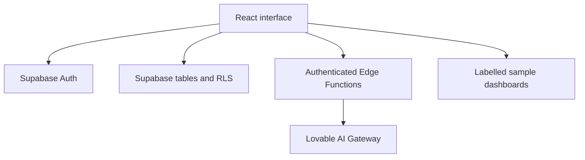

<div align="center">

# AthleTech

**Fitness planning prototype · React · TypeScript · Supabase**

Workout-plan generation, account onboarding and a collection of clearly labelled demonstration fitness dashboards.

Maintained by [viraj54](https://github.com/viraj54)

[Feature status](docs/FEATURES.md) · [Architecture](docs/ARCHITECTURE.md) · [Setup](docs/SETUP.md) · [Verification](docs/VERIFICATION.md)

</div>

## Overview

AthleTech is a web application prototype with Supabase account access, saved workout preferences and server-side AI workout-plan generation. It also includes interface demonstrations for workout sessions, progress charts, device connections, heart-rate views and safety alerts.

The original “Heart-Safe Fitness Assistant” name describes the project concept, not a validated safety capability. The application has no live heart-rate acquisition, cardiovascular-risk classifier, injury detector or emergency-alert system. Sample health values are marked as demonstration data in the interface.

## Feature status

| Feature | Current implementation |
|---|---|
| Account access | Supabase signup, login, sign-out and reset-email request |
| Workout preferences | Saves selected equipment, muscle groups, duration and notification flags to Supabase |
| AI workout plans | Calls an authenticated Edge Function and displays generated preview cards |
| AI guidance | Exercise-guidance Edge Function is supplied; the active screen currently shows fixed tips |
| Dashboard statistics | Reads `workout_sessions`; active-days count is distinct dates within the last seven days |
| Active workout | Fixed demonstration exercises, set progression and rest timer in local state |
| Session summary and charts | Sample values; not calculated from a saved session |
| Wearables and photos | UI demonstrations; no Bluetooth pairing or image upload backend |
| Safety alerts | Sample notifications and thresholds; no live monitoring |
| Subscription | Example plan cards; no payment processing |

[Complete page-by-page status and limitations](docs/FEATURES.md).

## Architecture



AI calls run on the backend. The browser uses a Supabase publishable/anon key; the AI gateway key remains server-only. The generated-plan feature requires a configured Supabase project and gateway access. [Architecture and data flow](docs/ARCHITECTURE.md).

## Stack

React 18 · TypeScript · Vite · Tailwind CSS · Radix/shadcn-style UI · React Router · TanStack Query · Recharts · Supabase Auth/Postgres/Edge Functions

## Run locally

Use Node.js 22 or newer and npm.

```sh
git clone https://github.com/viraj54/AthleTech-Heart-Safe-Fitness-Assistant.git
cd AthleTech-Heart-Safe-Fitness-Assistant
npm ci
```

Copy `.env.example` to `.env` and supply your project's browser configuration:

```dotenv
VITE_SUPABASE_URL=https://your-project-ref.supabase.co
VITE_SUPABASE_PUBLISHABLE_KEY=replace_with_your_publishable_or_anon_key
```

```sh
npm run dev
```

The development server uses port 8080. Without valid local configuration, the app displays a setup screen rather than connecting to the previously configured backend. The database migrations, redirect URLs and AI secrets must be configured separately; see [setup](docs/SETUP.md).

### Checks

```sh
npm run typecheck
npm run lint
npm test
npm run build
npm run preview
```

The automated tests exercise the backend authentication helper with mocked platform responses. They do not contact Supabase or an AI provider. Production-only dependency auditing reports zero findings; build-tool advisories remain and are listed in [dependency notes](docs/DEPENDENCIES.md).

## Repository layout

| Location | Purpose |
|---|---|
| `src/pages/` | Authentication, onboarding, workouts and demonstration screens |
| `src/components/` | Layout, setup/demo notices and reusable UI components |
| `src/contexts/` | Authentication state |
| `src/hooks/` | Preferences and workout-statistic queries |
| `src/integrations/supabase/` | Environment-based client and generated database types |
| `supabase/migrations/` | Schema, row-level policies and signup trigger |
| `supabase/functions/` | Workout generation, guidance and authentication helper |
| `tests/` | Network-free authentication-helper tests |
| `docs/` | Setup, feature status, architecture and verification |

## Data handling

Body metrics and preferences can be personal information. Workout generation sends the selected preferences and any fetched height/weight values to the configured AI gateway. The guidance endpoint can receive health-context fields from callers. Use synthetic data for demonstrations and review provider terms before processing personal information.

The repository contains no live project key, private `.env` file or user-data export. Browser keys are not database-administrator keys; row-level policies are still required. [Security notes](SECURITY.md).

## References and dependencies

- [Supabase](https://supabase.com/docs) for authentication, database access and Edge Functions.
- [Lovable AI Gateway](https://docs.lovable.dev/features/ai) for the retained AI integration.
- [React](https://react.dev/), [Vite](https://vite.dev/), [Tailwind CSS](https://tailwindcss.com/) and [Radix UI](https://www.radix-ui.com/).

Third-party packages retain their respective licenses. No gateway credential or pretrained-model ownership is implied by this project.

## License

Project-owned material permits noncommercial learning and demonstrations under [LICENSE.txt](LICENSE.txt). Commercial use requires written permission. Third-party terms remain unchanged.
